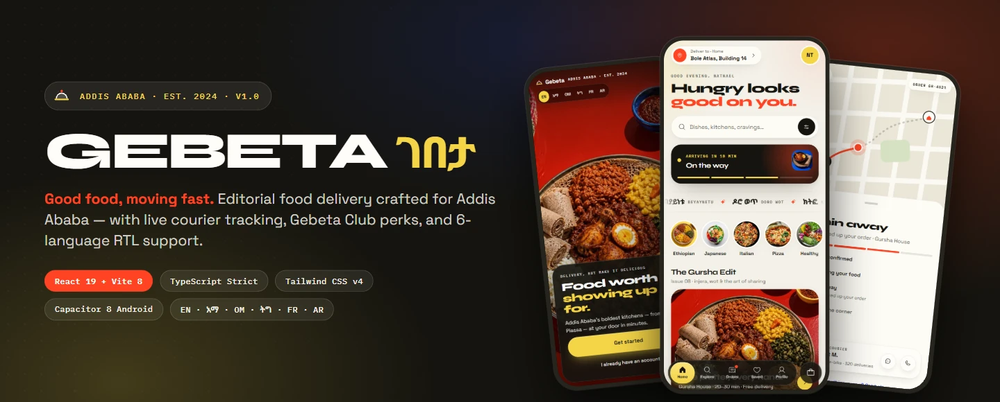
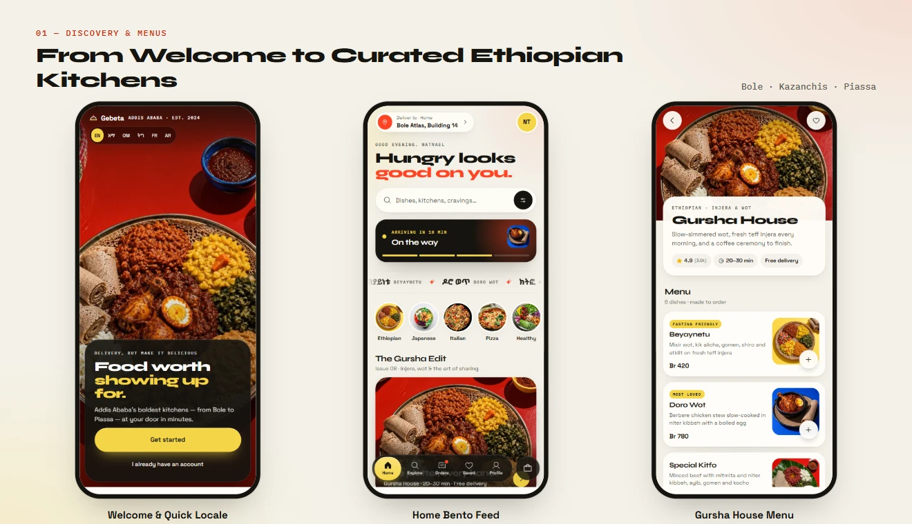
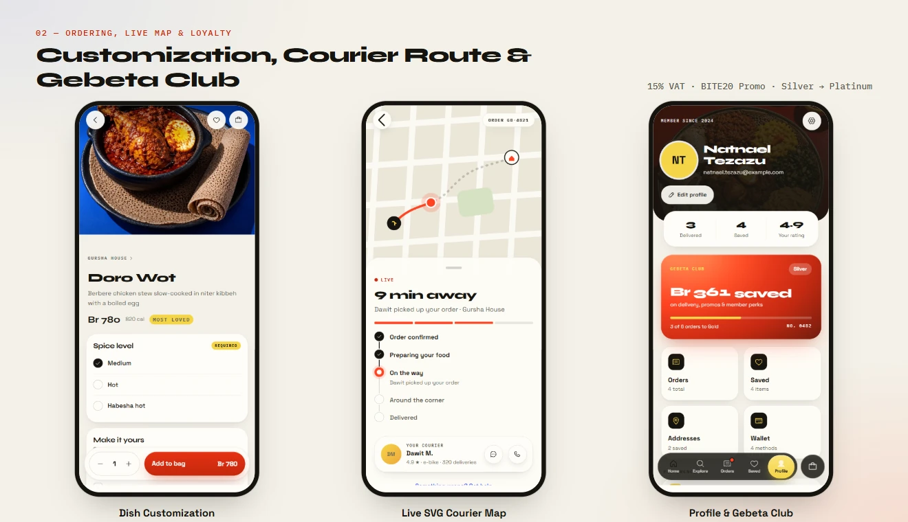
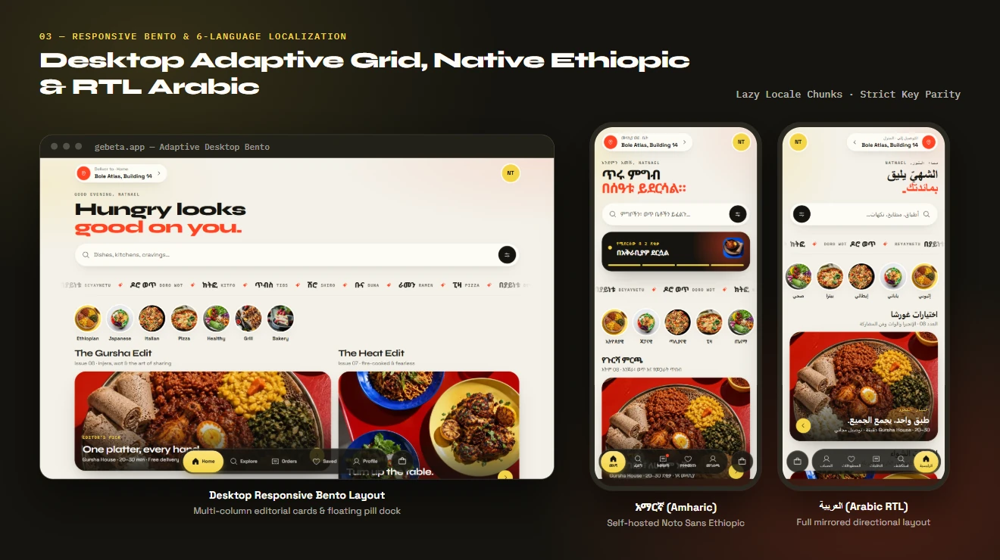
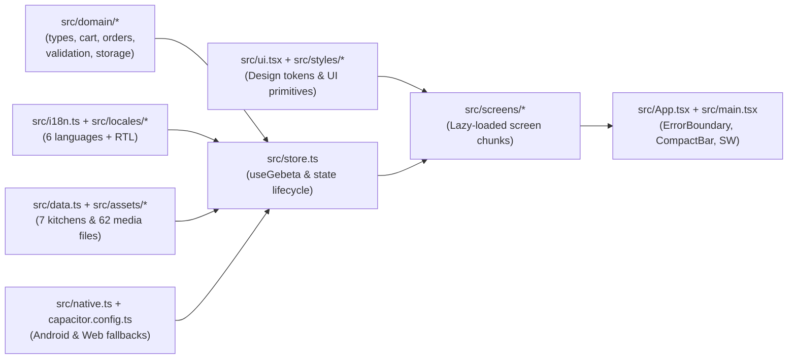

<div align="center">



<br />
<br />

# GEBETA · ገበታ

**Good food, moving fast — Addis Ababa's curated kitchen and food delivery experience for Web & Android.**

[](https://github.com/Natnael-Dev/Gebeta/actions/workflows/ci.yml)
[](LICENSE)
[](https://react.dev/)
[](https://www.typescriptlang.org/)
[](https://vite.dev/)
[](https://tailwindcss.com/)
[](https://capacitorjs.com/)

[Visual Tour](#visual-tour) · [Features](#features) · [Languages](#multilingual--rtl-support) · [Architecture](#architecture) · [Getting Started](#getting-started) · [Android](#capacitor-android-workflow) · [Prototype Scope](#prototype--simulation-notice)

</div>

---

## Overview

**Gebeta** (`ገበታ`) is a warm editorial food-delivery web application and native Capacitor Android app built around Addis Ababa's culinary landscape—spanning Bole, Kazanchis, Sarbet, CMC, and Piassa. It pairs a high-craft design system (`Space Grotesk`, `Syne`, `IBM Plex Mono`, and `Noto Sans Ethiopic` self-hosted via `@fontsource`) with a framework-agnostic TypeScript domain layer, lazy-loaded 6-language localization (including full RTL Arabic), and native Android hardware integration.

---

## Visual Tour

### Discovery, Editorial Feeds & Curated Menus



### Dish Customization, Live Courier Route & Gebeta Club



### Responsive Desktop Bento & Multilingual RTL Rendering



---

## Features

- **Editorial Bento Discovery:** Time-aware greeting, neighborhood selector across 9 Addis Ababa areas, live active-order banner, dual-script marquee, cuisine rail, and curated _Gursha Edit_ & _Heat Edit_ spotlights.
- **7 Curated Kitchens & Customizations:** Ethiopian classics (_Gursha House_ — Beyaynetu, Doro Wot, Special Kitfo, Derek Tibs, Shiro, Buna Ceremony) alongside Japanese, Italian, Wood-Fired Pizza, Healthy Bowls, Grill, and Bakery menus.
- **Ethiopian Birr (`Br`) Checkout Engine:** Computes item extras, free delivery over `Br 1,000`, Priority delivery (`+Br 60`), capped 5% service fee (`Br 150` cap), 15% VAT, scheduled 30-minute delivery windows, and promo code `BITE20` (`20%` off up to `Br 300`).
- **Live Order Tracking & Loyalty:** Animated SVG delivery route with real-time stage progression (`12s` per simulated stage), automatic reconciliation to delivered history, post-delivery star reviews, and _Gebeta Club_ tier progression (`Silver` → `Gold` → `Platinum`).
- **Hardened Client Persistence:** Validated `localStorage` hydration (`gebeta.state.v1` with one-time legacy `morsel.state.v1` migration), automatic PAN masking, CVC/PAN field stripping, and SVG XSS media sanitization.
- **Installable Web App & Capacitor Native Bridge:** Unified platform layer (`src/native.ts`) handling Android status/navigation bar styling, haptics, geolocation, local notifications, keyboard viewport offsets, and hardware back navigation; `public/sw.js` handles PWA registration and notification clicks.

---

## Multilingual & RTL Support

Locale dictionaries load lazily on demand (with English bundled directly) and are verified for strict key parity by `tests/domain.test.ts`:

| Language     | Native Label   | Script / Code   | Direction | Chunk                |
| ------------ | -------------- | --------------- | --------- | -------------------- |
| English      | `English`      | Latin (`en`)    | `LTR`     | Base (`src/i18n.ts`) |
| Amharic      | `አማርኛ`         | Ethiopic (`am`) | `LTR`     | `src/locales/am.ts`  |
| Afaan Oromoo | `Afaan Oromoo` | Latin (`om`)    | `LTR`     | `src/locales/om.ts`  |
| Tigrinya     | `ትግርኛ`         | Ethiopic (`ti`) | `LTR`     | `src/locales/ti.ts`  |
| French       | `Français`     | Latin (`fr`)    | `LTR`     | `src/locales/fr.ts`  |
| Arabic       | `العربية`      | Arabic (`ar`)   | **`RTL`** | `src/locales/ar.ts`  |

---

## Architecture



### Project Layout

```text
Gebeta/
├── .github/                  # GitHub Actions CI workflow & PR/Issue templates
├── docs/assets/              # README hero & showcase visuals (.webp)
├── public/                   # PWA manifest, notification SW, app icons, robots.txt, llms.txt
├── src/
│   ├── assets/               # Dish photography, thumbnails, and Ethiopian payment SVGs
│   ├── components/           # ErrorBoundary with safe local-state recovery
│   ├── domain/               # Pure TS business logic: cart, orders, validation, storage, types
│   ├── locales/              # Lazy-loaded translation dictionaries (am, ar, fr, om, ti)
│   ├── screens/              # Lazy-loaded Auth, Home, Discovery, Ordering, Tracking, Account, Sheets
│   ├── styles/               # Tokens, self-hosted @fontsource WOFF2 rules, shell, screens, motion
│   ├── utils/                # Client-side image resize & WebP compression
│   ├── App.tsx               # Shell, lazy route registry, modal inert isolation
│   ├── data.ts               # Curated Addis Ababa kitchens, menus, neighborhoods, seed orders
│   ├── i18n.ts               # Typed dictionary, interpolation, pluralization & locale loader
│   ├── icons.tsx             # Inline Phosphor-style SVG path registry
│   ├── main.tsx              # React 19 mount & service worker registration
│   ├── native.ts             # Capacitor 8 Android / browser capability bridge
│   ├── store.ts              # Centralized useGebeta state hook & navigation transitions
│   └── ui.tsx                # Shared editorial UI primitives
├── tests/
│   └── domain.test.ts        # 24 unit tests across 6 suites (node:test)
├── capacitor.config.ts       # Capacitor app config (appId: app.gebeta.delivery)
├── index.html                # App HTML entry
├── package.json              # Scripts, dependencies, pnpm@12.21.0 pin
├── tsconfig.json             # Strict TypeScript config
└── vite.config.ts            # Vite 8 + React + Tailwind CSS v4 config
```

---

## Getting Started

### Prerequisites

- **Node.js `>= 22.18`** (**`24 LTS` recommended** — `pnpm test` runs `tests/domain.test.ts` directly with Node's native TypeScript execution)
- **pnpm `12.21.0`** (pinned in `package.json` and `.mise.toml`)

### Install & Run Locally

```bash
git clone https://github.com/Natnael-Dev/Gebeta.git
cd Gebeta
pnpm install --frozen-lockfile
pnpm run dev
```

### Available Scripts

| Command                  | Description                                                                                      |
| ------------------------ | ------------------------------------------------------------------------------------------------ |
| `pnpm run dev`           | Start Vite development server (default port `8443`, configurable via `PORT`)                     |
| `pnpm run build`         | Build production bundle into `dist/`                                                             |
| `pnpm run preview`       | Preview the production `dist/` bundle locally                                                    |
| `pnpm run typecheck`     | Run strict TypeScript check across `src/`, `tests/`, `vite.config.ts`, and `capacitor.config.ts` |
| `pnpm test`              | Run all `24` unit tests in `tests/domain.test.ts` via `node --test`                              |
| `pnpm run format`        | Format repository files with `oxfmt`                                                             |
| `pnpm run format:check`  | Verify `oxfmt` formatting rules (`.oxfmtrc.json`)                                                |
| `pnpm run cap:sync`      | Build `dist/` and sync assets to Capacitor Android                                               |
| `pnpm run android:build` | Build and package Capacitor Android project                                                      |
| `pnpm run android:run`   | Sync and run on a connected Android device/emulator                                              |

---

## Capacitor Android Workflow

To add and run the native Android shell locally:

```bash
pnpm exec cap add android
pnpm run android:run
```

If your Android native project lives in a custom directory outside this repo, set `CAP_ANDROID_PATH` before syncing:

```powershell
$env:CAP_ANDROID_PATH = "C:/path/to/your-android-project"
pnpm run cap:sync
```

---

## Prototype & Simulation Notice

Gebeta is currently a **client-side web and mobile UI prototype** backed by browser `localStorage`:

- **Authentication & OTP:** Sign-up, login, password reset, and 4-digit OTP screens validate formatting locally and accept any 4-digit verification code.
- **Payments & Promo:** Card validation checks format, expiration, and Luhn checksum locally; card numbers/CVCs are stripped before persisting masked last-4 metadata (`•••• 4821`). Promo code `BITE20` applies a simulated 20% discount (`Br 300` cap). No real charges occur.
- **Order Tracking & Support Chat:** Active orders advance through 5 stages (`12s` per stage) via client timers, and courier/support chats return simulated responses.
- **Service Worker (`public/sw.js`):** Handles PWA installation and notification click focus (`not` offline asset caching).

---

## Contributing & Security

- Read [CONTRIBUTING.md](CONTRIBUTING.md) for branching conventions, Conventional Commits, and pre-PR verification steps.
- Read [SECURITY.md](SECURITY.md) for prototype boundaries and private vulnerability reporting.
- Licensed under the [MIT License](LICENSE).
